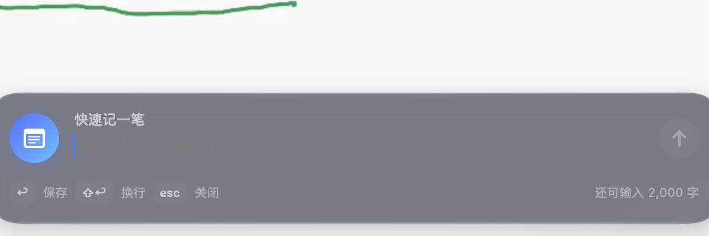
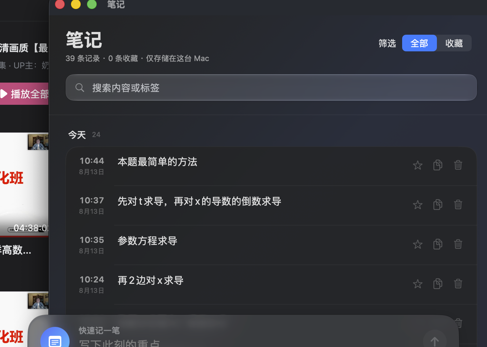

# VideoNotes

在全屏视频上方随时唤出的 macOS 原生速记工具。

按 `⌘⇧Space`，写下重点并回车保存；笔记会复制到剪贴板并留在本机历史中。开始一个视频会话后，每条笔记还会自动附上相对视频时间。按 `⌘⇧H` 查看、搜索、收藏、编辑或导出记录。

## 产品能力

- 全局快捷键唤出，不依赖辅助功能或输入监控权限
- 覆盖 Safari、Chrome、QuickTime 等全屏空间
- `Enter` 保存、`Shift+Enter` 换行、`Esc` 关闭
- 视频会话：开始、暂停、继续、结束；会话时间在重启后以暂停状态安全恢复
- 本地历史、收藏筛选、全文搜索、编辑；可在“视频”视图按会话与时间点浏览
- 历史记录支持自定义范围导出 PDF 或复制 Markdown，可按当前筛选、全部、收藏、今天、昨天、最近 7 天或自定义日期处理
- 设置中支持一键导出 `.videonotesbackup` 可迁移备份，并在另一台电脑选择“加载备份”后合并或替换；笔记、视频会话和截图附件会一起迁移
- 增强版支持连接本机 Codex CLI，把选定范围的笔记整理为结构化复盘，并直接生成复盘 PDF
- 可选 DeepSeek AI 复盘（今天/昨天/本周/全部或单个视频）、一键飞书群机器人推送，以及通过安全 Relay 在已绑定群中发起复盘
- 增强版在生成“今天 / 昨天”AI 复盘后，会原子归档到 `~/Documents/DailyReview/YYYY-MM-DD.md`，供本机飞书复盘机器人按日期回复
- macOS 26+ 使用原生 Liquid Glass，macOS 13–15 自动使用 Material 回退
- 标准版使用 App Sandbox；两个版本均使用 Hardened Runtime 与 Keychain 密钥保护
- 菜单栏常驻，不占用 Dock

## 隐私

- 历史记录默认只保存在本机应用容器中。
- 可迁移备份是用户主动导出的 JSON 快照；截图附件会内嵌到备份文件中。备份不会包含 DeepSeek API Key、飞书密钥、Relay 设备令牌或本地 Codex 路径。
- DeepSeek API Key、飞书群机器人 Webhook 与可选签名密钥，以及安全 Relay 的设备令牌，均保存到 macOS 钥匙串，不写入明文配置文件。Relay 所需的 App Secret 仅保留在服务器端，不会下发到应用或写入本机。
- 飞书群机器人 Webhook 推送仅在用户于 AI 看板中主动点击“发送到飞书群”时发生。
- 安全 Relay 必须先由用户主动完成设备配对和群绑定；它只接收飞书投递给机器人的群 @ 消息，不主动拉取普通群消息或聊天历史。为验证绑定者和回复原消息，它会处理群、绑定者 Open ID、消息和设备标识，以及最终复盘正文。
- Relay 会对服务器状态文件做静态加密，并暂存复盘正文以支持失败重试和重启恢复；这不是端到端加密。已完成的正文通常在命令过期约 7 天后清理；未完成群绑定的已领取设备默认最多保留 1 小时以支持丢失响应后的安全重试，实际清理可能因服务停机而延后。
- 用户可在设置中“安全断开”。Relay 确认后会撤销设备与群绑定、删除已领取配对记录、清除活动状态中的复盘正文并取消尚未发送的回复；已发送或已交给飞书的消息无法召回。撤销令牌哈希、不含正文的命令元数据和运营方备份仍按各自周期处理。
- 只有用户主动生成 AI 复盘、手动发送到飞书群，或在已绑定群中发起上述复盘命令时，相关复盘内容才会发送到所配置的服务。
- 应用不包含广告、分析 SDK 或跨应用跟踪。

## 构建

项目文件位于仓库根目录：`VideoNotes.xcodeproj`。增强版当前工程版本为 **1.2.8（构建 13）**。

```bash
DEVELOPER_DIR=/path/to/Xcode.app/Contents/Developer \
xcodebuild \
  -project VideoNotes.xcodeproj \
  -scheme VideoNotes \
  -configuration Release \
  build
```

最低系统版本为 macOS 13。使用 Xcode 26/27 构建时，会为新系统编译原生玻璃效果，同时保留旧系统兼容路径。

### 私有媒体接口增强版

工程另含独立的 `VideoNotes-Enhanced` scheme，用于构建非 App Store 增强版：

```bash
DEVELOPER_DIR=/path/to/Xcode.app/Contents/Developer \
xcodebuild \
  -project VideoNotes.xcodeproj \
  -scheme VideoNotes-Enhanced \
  -configuration Release \
  build
```

增强版通过 macOS 私有 MediaRemote 接口自动读取系统当前媒体的标题、真实播放进度、时长与播放状态。它使用独立 Bundle ID 和独立数据目录；首次启动仅在目标文件不存在时，从标准版容器复制现有 JSON 数据，不移动、不覆盖或反向写入标准版数据。

使用方式：先在哔哩哔哩、Safari、QuickTime 等应用中开始播放，再按 `⌘⇧Space`。输入框顶部出现“自动”标记后，按 Enter 保存的笔记会自动附上播放器标题与真实进度，无需手动开始视频会话。播放器只有在 Now Playing 元数据中提供公开 HTTP(S) 地址时才会保存链接；哔哩哔哩 macOS 客户端目前通常只提供标题和进度，因此链接留空属于正常行为。

私有接口可能随 macOS 升级失效，增强版不得提交 App Store。标准 `VideoNotes` target 不编译增强媒体源码，也不包含对应私有框架名称或符号。两个版本使用相同全局快捷键，应用会阻止它们同时运行。

### 本机飞书复盘归档

VideoNotes Enhanced 完成“今天”或“昨天”的 AI 复盘后，会保留原有的复制和可选飞书推送行为，并额外以原子写入方式更新：

```text
~/Documents/DailyReview/YYYY-MM-DD.md
```

这是本机 `DailyReviewBot` 的唯一读取目录。这样在飞书群中发送 `@机器人 昨天复盘` 时，机器人只读取已经由用户明确生成的本地复盘，不读取普通群消息，也不会自行调用 AI 或上传全部历史笔记。

### 本地 Codex 复盘 PDF

`VideoNotes Enhanced` 的设置中新增“本地 Codex”页面。留空时会自动检测 ChatGPT.app 或 Codex.app 内置的 CLI，也可以手动选择可执行文件并测试连接。历史记录窗口的“导出 / 复制”支持选择范围后执行“Codex 复盘 PDF”，生成后会自动保存到“数据与备份”中配置的复盘 PDF 目录，不再重复弹出保存窗口。应用通过 `codex exec` 的只读模式调用本机 CLI，只发送当前选中的笔记，不修改项目文件；首次使用前请确认本机 Codex CLI 已登录。

标准版仍受 App Sandbox 限制，建议使用非 App Store 的 `VideoNotes Enhanced` 来调用外部 Codex CLI。两个版本的 PDF 导出、Markdown 复制和可迁移备份功能均可独立使用。

## App Store 发布

发布前请完成 `AppStore/RELEASE_CHECKLIST.md`。其中必须由开发者账号持有人完成的项目包括：

- 设置唯一 Bundle ID 与 Apple Developer Team
- Archive 并通过 Xcode Organizer 验证
- 将隐私政策发布到公开 HTTPS 地址
- 准备 App Store 截图、支持网址和审核联系信息
- 在 App Store Connect 中按 `PrivacyInfo.xcprivacy` 如实填写 App Privacy

## 工程结构

```text
VideoNotes/
├── App/               应用生命周期与菜单栏
├── Window/            悬浮输入面板与视觉系统
├── History/           历史记录界面
├── Settings/          设置中心
├── Video/             视频会话计时与持久化
├── Stores/            本地持久化、PDF 导出与可迁移备份
├── AI/                DeepSeek / Codex 复盘与钥匙串封装
├── Feishu/            飞书群机器人复盘推送
├── Relay/             可选的安全飞书指令中继（独立服务器，不随 App 打包）
├── Assets/            全尺寸 AppIcon
├── AppStore/          上架材料草案与检查清单
├── PrivacyInfo.xcprivacy
└── VideoNotes.entitlements
```

## 历史界面截图

以下为早期版本截图，供了解基本交互；最新功能以本文与源码为准。




